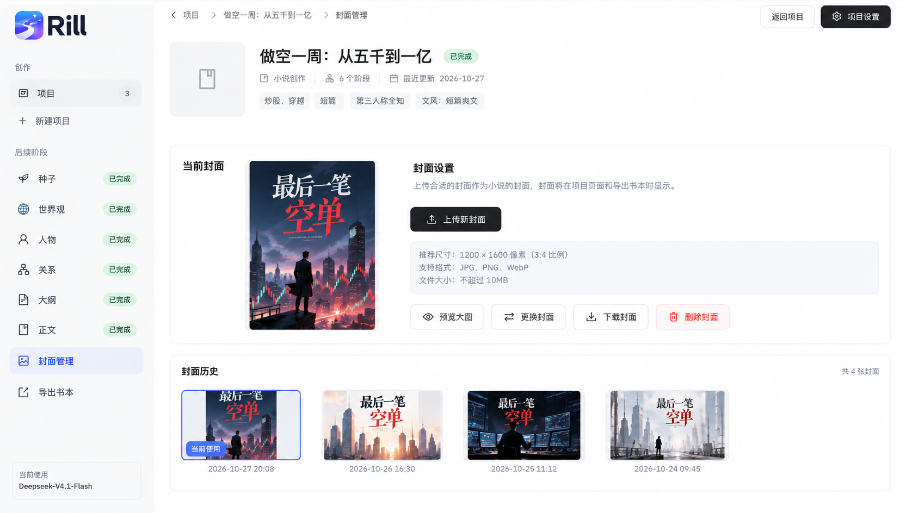

# 封面管理模块设计

日期：2026-10-27
状态：已按本设计实施；测试与视觉验收记录见 docs/qa/cover-management/acceptance.md。
设计依据：用户提供的 UI 为本模块页面与功能基准，替代上一版单卡片、无历史记录方案。

## 1. 设计基准与范围



本图仅作为设计参考，不将图中的书名、封面图片、四张历史记录和时间当作真实项目数据。实际内容必须来自当前项目。截图中的封面文字已经属于图片，不另做书名叠字。

相较上一版的调整：

| 方面 | 本版决定 |
| --- | --- |
| 页面布局 | 上方「当前封面 + 封面设置」，下方独立「封面历史」卡片 |
| 上传入口 | 主卡片右侧深色「上传新封面」按钮；不在常态页面放大型拖拽区 |
| 上传规格 | 推荐 1200 × 1600 像素、3:4 比例，支持 JPG、PNG、WebP，不超过 10 MB |
| 当前封面操作 | 预览大图、更换封面、下载封面、删除封面 |
| 历史 | 保存成功的封面保留记录，显示缩略图、上传时间、总数和「当前使用」标记，支持重新启用 |
| 保存交互 | 选图后在弹窗内预览并确认；常态页面不额外放保存按钮 |
| 视觉 | 蓝色浅底选中导航、蓝色当前封面描边与徽标、深色上传按钮、红色描边删除按钮 |

封面是项目的可选书籍资源，侧栏顺序为「正文 → 封面管理 → 导出书本」。不增加流水线阶段或确认步骤，不改变“全部正文有效接受即创作完成”的规则。任意创作阶段均可进入；未上传也可导出。

首版支持已有成品图片的上传、预览、更换、下载、删除、历史切换，以及项目列表、概览和 EPUB 联动。不提供 AI 生图、裁剪、文字编辑、模板或小说平台上传。

## 2. 页面结构与视觉规格

### 2.1 外壳、导航与项目概览

- 面包屑为「项目 > 项目名称 > 封面管理」，当前页文字不作为可点击链接。
- 顶部右侧依照参考图显示「返回项目」「项目设置」。「返回项目」回到当前项目的默认创作工作台，不回项目列表；面包屑「项目」回列表。项目设置复用已有推进模式弹窗。
- 左侧在正文之后、导出书本之前增加图片图标与「封面管理」，选中时使用浅蓝底和蓝色图标/文字；不增加「已完成」「已上传」状态胶囊，与参考图一致。
- 项目概览保留项目名、实际阶段数、运行状态、最近更新和问卷维度；封面不计入阶段数。当前封面存在且可用时概览展示真实缩略图，无图时保留占位。
- 图中项目概览仍为占位，按已确定的展示联动补全真实封面；不更改其他阶段的导航或统一改造全站品牌。

### 2.2 当前封面与封面设置

内容区上方为一张横向白色主卡片：左侧「当前封面」和图片，右侧「封面设置」、说明、上传按钮、规格提示块及四个操作按钮。

```text
┌──────────────────────────────────────────────────────────┐
│ 当前封面                封面设置                          │
│ ┌────────────┐          上传合适的封面作为小说的封面，      │
│ │            │          用于项目展示和 EPUB 导出。         │
│ │ 当前封面图 │          [↑ 上传新封面]                    │
│ │            │                                            │
│ │            │          推荐尺寸：1200 × 1600 像素（3:4） │
│ └────────────┘          支持格式：JPG、PNG、WebP            │
│                         文件大小：不超过 10MB              │
│                         [预览大图][更换封面][下载封面][删除封面]│
└──────────────────────────────────────────────────────────┘
┌──────────────────────────────────────────────────────────┐
│ 封面历史                                      共 N 张封面 │
│ [当前缩略图]   [历史缩略图]   [历史缩略图]   [历史缩略图]   │
│ 当前使用         上传时间       上传时间       上传时间    │
└──────────────────────────────────────────────────────────┘
```

规格提示块按参考图使用浅灰蓝底和细边框。正文文案明确「EPUB 导出」以免作者误以为 TXT 也能包含图片。另用简短辅助文字说明：请上传已包含所需书名与作者文字的成品图片。

桌面当前封面展示框约 240 × 320px，比例 3:4；上传图片本身可为其他比例，使用 `object-fit: contain` 和白色背景完整显示，不能裁掉文字。

「上传新封面」和「更换封面」打开同一个文件选择与确认流程；前者是明显的主要入口，后者归入当前封面的工具组。已有当前封面时两者均保存新记录并切换当前引用，保留旧记录，不覆盖旧图片文件。

### 2.3 封面历史

- 下方独立卡片，标题「封面历史」，右侧「共 N 张封面」。数量为未删除的成功保存记录，包含当前使用的那一张；空白项目显示 0，选图和上传失败不计数。
- 当前记录固定排第一，其余按上传时间降序；切换当前封面不会改写上传时间。图中的四张图仅为示例，不能固定写四个槽位。
- 当前卡片采用蓝色描边，左下角蓝色「当前使用」徽标；其他卡片为中性描边。颜色之外也用文字标识当前项。
- 缩略图展示框参照图中横向卡片，约 220 × 130px，图片居中完整缩放，空白区域用浅灰底补足。卡片下方显示本地时区的上传时间 `YYYY-MM-DD HH:mm`。
- 点击历史卡片打开详情弹窗：完整图、文件名、尺寸、格式、大小和上传时间；可「下载封面」，非当前且可用的记录可「设为当前封面」。当前记录显示禁用的「当前使用」按钮。
- 「设为当前封面」是显式操作，仅点击缩略图不会立即切换。成功后刷新主图、当前标记、项目概览与列表摘要，提示「已切换当前封面」，不新建历史记录。
- 没有记录时显示「暂无封面历史，上传封面后将在这里保留记录」。无当前图但有历史时，提示「可从历史中选择一张设为当前封面」。
- 历史每页最多 12 条，超出显示分页；第一页优先展示当前记录。总数统计完整历史，切换后返回第一页，避免当前标记落在其他页。

### 2.4 主题、响应式与可访问性

复用已有 React、Ant Design 和基础字体、文本/边框 token。本模块按参考图使用主题蓝色选中态，深色主按钮保持现有风格；间距采用 8/12/16/24/32px，卡片约 12px 圆角、24px 内边距，标题 16px/600、正文 14px、辅助文字 12px。

以内容区可用宽度适配：不少于 1000px 时主卡左右布局、历史最多四列；680–999px 时收紧列间距、历史两至三列；不足 680px 时主卡改为单列、历史两列，极窄时单列。四个操作按钮自动换行，不产生页面横向滚动，触控区域至少 44px 高。

缩略图卡片使用可聚焦按钮，支持 Enter/Space 打开详情，当前项提供可读状态。图标配中文标签；错误与操作结果提供可读状态提示。弹窗打开后管理焦点，关闭后返回触发按钮；Escape 可关闭预览/未提交弹窗。保存期间禁止重复提交，并提示正在保存；焦点样式始终可见。

## 3. 操作流程与状态

### 3.1 上传与更换

点击「上传新封面」或「更换封面」→ 选择文件 → 浏览器初步校验 → 弹窗展示本地预览、文件信息和比例提醒 → 「取消」或「保存并使用」。弹窗内可重新选择图片，保持常态页面与参考图一致。

保存前不会上传或改变当前封面。确认后按钮 loading，后端完成规范化、写入和数据库提交后再切换主图，并新增历史卡片。失败时保留本地选择与原封面，可重试；取消时释放本地 object URL。上传结果不确定时先重新读取状态，不能仅凭前端超时认定保存失败并重复新增。

### 3.2 预览与下载

「预览大图」打开当前已保存图片的 Ant Design 预览；历史卡片打开带操作的详情弹窗。

「下载封面」下载指定记录的完整、已规范化文件，不下载缩略图，也不生成整本书。文件名采用安全处理后的项目名与封面标识，扩展名与实际 MIME 一致。辅助说明明确已规范化，不承诺与上传文件字节完全相同。服务端通过附件响应提供下载，前端不拼接本地磁盘路径。

### 3.3 删除封面

主卡片红色「删除封面」删除当前封面记录并清空当前引用，确认文案为：

> 删除当前封面后，项目将恢复默认占位，该图片也会从封面历史中移除。已生成的历史导出不受影响。

成功后主图回到占位、历史总数减一，保留其他历史记录；不自动选择下一张封面。历史记录可在详情中设为当前后再删除，首版不额外增加批量删除或历史卡片上的删除按钮。

删除影响当前资源和历史记录；历史导出已经持有独立快照，不能连带删除。数据库先标记记录删除并清空当前引用，实际源图及缩略图随后清理；清理失败保留待清理信息供重试，不恢复为可选历史记录。

### 3.4 状态表

| 状态 | 页面行为 |
| --- | --- |
| 首次读取中 | 主图与历史骨架，操作暂不可用，不提前显示 0 条 |
| 无当前封面 | 主图区显示占位与「尚未设置封面」，上传可用；四个当前图操作禁用 |
| 已设置 | 显示主图、全部工具与当前历史标记 |
| 待保存 | 弹窗本地预览，不更改主页面和历史总数 |
| 保存/切换/删除中 | 对应按钮 loading，串行处理当前项目的修改，避免重复提交 |
| 上传格式/大小不符 | 弹窗就地提示原因，保留原当前图 |
| 保存/切换冲突 | 保留本地选择，重新读取当前状态与历史，提示作者核对，不自动覆盖 |
| 当前文件缺失/损坏 | 主图区显示「封面文件不可用」，支持更换、删除或选择其他历史图；预览和下载禁用 |
| 历史文件不可用 | 该卡片显示异常占位，可查看错误说明，禁止启用与下载 |
| 历史读取失败 | 主卡片仍可使用，历史区域单独显示重试入口 |

关闭含本地待保存图的弹窗时提示「放弃这张尚未保存的封面？」；应用内离开也遵守此规则。请求进行中阻止重复操作；强制关闭或断网后以服务端重新读取结果为准。

## 4. 上传规格与图片处理

- 接受静态 JPEG、PNG、WebP，输入文件不超过 10,000,000 字节，与 UI 的 10 MB 一致。不接受 GIF、SVG、PDF、远程 URL 或动画多帧文件。
- 推荐 1200 × 1600 像素、3:4；其他比例、低于推荐尺寸仅提醒，允许保存，不强制裁剪、放大或拉伸。此建议不代表特定小说平台要求。
- 解码后最长边不超过 8192 像素，总像素不超过 2400 万；后端核验真实格式并完成解码，不信任扩展名和浏览器 MIME。
- 使用 sharp 修正 EXIF 方向、转换至 sRGB、移除元数据并重新编码。JPEG 存 JPEG，PNG 存 PNG，WebP 转成 PNG；保留透明通道。接受格式与下载格式可以不同，确认弹窗明确提示「WebP 将保存为 PNG」。
- WebP 统一转 PNG，使展示、下载和 EPUB 使用同一份规范化资源，避免给 EPUB 引入 WebP 阅读器兼容分支。10 MB 限制针对输入文件，规范化输出另受像素与资源预算控制。
- 同时生成一张宽不超过 480px、保持比例且不放大的缩略图，供项目列表、概览及历史加载；主图和下载使用完整规范化图片。
- 浏览器预览使用 object URL，取消、换图和卸载时释放。图片不以 Base64 写入 SQLite 或 localStorage。

## 5. 技术栈与工程接入

| 层次 | 选型与职责 |
| --- | --- |
| 前端 | 现有 React 19、TypeScript、Vite；新增 CoverWorkbench、CoverHistory、上传确认弹窗和 api/cover.ts |
| UI | Ant Design 5 的 Button、Modal、Image、Upload、Pagination；图标沿用 @ant-design/icons |
| 共享契约 | @rill/shared + Zod，覆盖资源、当前状态、历史分页、切换与删除请求 |
| 上传 | 现有 NestJS 11 + Express，FileInterceptor/Multer 接收 multipart，限制文件数和输入大小 |
| 图片处理 | 新增 sharp；实施时验证 Node 24 的安装与运行，锁定实际版本 |
| 存储 | Prisma 7 + SQLite 保存状态与历史元信息；图片、缩略图保存在本地 output |
| 导出 | 复用书本快照、EPUB 渲染器和 fflate，增加封面快照与封面页 |
| 验证 | Jest、supertest、Vitest + Testing Library，配合浏览器视觉验收 |

不新增全局状态库、云存储、Redis 或 AI 调用。封面服务独立于 LangGraph，不产生 token 用量。

接入位置：`frontend/src/App.tsx` 插入导航；`useWorkspaceProject.ts` 新增 `{ kind: 'cover' }`；`ProjectWorkspacePage.tsx` 分发封面工作台；`ProjectListPage.tsx` 消费封面摘要。后端新增 `novel/cover/` 模块，共享契约先定义于 `shared/src/index.ts`。

## 6. 数据模型与 API

### 6.1 当前引用与历史资源分离

上一版单条 ProjectCover 记录不满足历史需求，本版拆为两类数据：

| 模型 | 主要字段与规则 |
| --- | --- |
| ProjectCoverState | projectId 唯一外键、revision、currentAssetId 可空、updatedAt；未设置时 revision 为 0，首次修改时创建 |
| CoverAsset | id、projectId、sourceFormat、mimeType、path、thumbnailPath、width、height、size、sha256、originalFilename、createdAt、deletedAt；一项目多条记录 |

资源文件不可变；每次上传新的有效内容创建一条资源记录。当前状态引用必须属于同一项目且未删除。切换历史只更新引用及 revision，不复制文件或改写上传时间。删除当前资源后状态记录保留 revision，不能因无封面而重置为 0。

哈希按规范化后的完整图片字节计算；同项目已有相同哈希且文件有效时复用记录并设为当前，不重复新增历史；命中软删除记录时不复用。相同当前记录的重复启用直接返回现状。数据库事务结合当前 revision 保证并发上传不会产生重复历史。

拟定共享契约：`CoverAssetSchema`、`ProjectCoverStateSchema`、`CoverHistoryPageSchema`、`ActivateCoverSchema`、`DeleteCurrentCoverSchema`。资源返回 `fileStatus: available | missing | corrupt`；状态含 revision 和可空 currentCover。历史页包含 items、total、page、pageSize，每项标记 isCurrent。

项目详情与列表增加当前封面轻量摘要（assetId、revision、资源状态），不逐项请求历史。摘要查询不重复解码图片；资源读取异常时前端显示占位并刷新状态，不将损坏误认成未上传。

### 6.2 API

以下路径均相对于 `/api/novel/projects/:id`，避免重复拼接 cover 前缀：

| 方法 | 路径 | 语义 |
| --- | --- | --- |
| GET | `/cover` | 当前状态与 revision |
| POST | `/cover/assets` | multipart：file + expectedRevision；保存新资源或复用同内容资源，原子设为当前 |
| GET | `/cover/assets?page=1&pageSize=12` | 分页历史，包含当前标记与完整总数 |
| GET | `/cover/assets/:assetId/image?variant=full` | 获取指定未删除资源的图片；variant 支持 full / thumbnail |
| GET | `/cover/assets/:assetId/download` | 校验后以 attachment 返回完整图片 |
| PATCH | `/cover/current` | JSON：assetId + expectedRevision；将历史图设为当前 |
| DELETE | `/cover/current` | JSON：assetId + expectedRevision；删除指定当前资源并清空引用，防止误删已切换的新图 |

上传、更换、切换与删除递增 revision；历史翻页、预览、下载不修改版本。状态冲突返回 409 并保留前端本地选择；成功响应返回权威当前状态，前端刷新历史和共享项目摘要。历史切换读前校验原图与哈希，可重建丢失的缩略图；完整图损坏时不得启用。

图片接口核验项目及资源归属、未软删除，返回准确 Content-Type、nosniff 与 Cache-Control: no-store；不能靠静态目录绕过回收站保护。下载文件名清除路径与响应头非法字符。400 表示非法请求/格式，413 输入过大，422 无法解码/尺寸超限，404 项目或资源不可访问；磁盘失败提供可重试错误，不记录图片内容或敏感信息。

### 6.3 文件与一致性

```text
output/{projectId}/
├── covers/{assetId}/
│   ├── cover.jpg 或 cover.png
│   └── thumbnail.png
└── exports/{jobId}/snapshot/cover/
    └── cover.jpg 或 cover.png
```

沿用 PROSE_OUTPUT_DIR 与现有项目路径保护，服务端生成 assetId，用户文件名不参与路径。完整图及缩略图写入受限临时目录，校验完成后原子发布；数据库事务再次核对项目未删除、expectedRevision 和资源归属，再插入记录与切换引用。失败清理尚未引用的新文件，旧当前资源与历史不变。

更换成功后不清理旧图，它是历史资源。只有作者显式删除当前图或永久删除项目时才清理相应文件。删除标记持久化后可重试文件清理；启动时可清理超时且没有数据库引用的临时/孤立文件，不能按“非当前”条件回收历史。

封面修改、删除和导出准备在单后端实例内共用项目级资源锁，避免导出复制途中源图被删除。数据库 revision 为最终并发校验；不使用多实例部署假设。上传流、解码像素、并发和临时文件均设资源限制。

软删除项目保留全部封面资源，恢复时核验；永久删除复用项目输出目录清理流程。备份仍须保存数据库、checkpoint 与完整 output。

## 7. 项目展示、导出与历史兼容

项目列表、概览和导出页均使用已保存的当前资源；上传弹窗预览不提前更新这些位置。删除后显示占位，历史切换后同步刷新，图片加载失败显示异常提示。

导出页增加小图、已设置/未设置和「管理封面」链接。无封面允许正常导出；封面操作不隐式保存导出页尚未提交的成书信息，离开时保留未保存提醒规则。

| 输出 | 行为 |
| --- | --- |
| EPUB | 嵌入当前规范化图片、封面声明和独立封面页，置于书籍信息页之前 |
| TXT | 保持纯文字，不加入图片路径或占位文案 |
| Markdown | 保持单个文字文件，不引用本地图片接口 |

任务准备时复制当前完整图到独立快照，并记录相对路径、哈希、MIME 和尺寸；历史换图或删除不影响已建立快照。三种格式仍共用快照：已配置但损坏的当前封面阻止新任务，提示重传、切换可用历史图或删除后重试；章节复制不依赖封面。

内容指纹与 previewToken 纳入规范化图片哈希/无封面状态。更换为不同内容、删除或切换为不同内容历史图均使旧预览失效，旧任务标为历史版本；即使 TXT / Markdown 字节不变，也沿用共享版本判定。完全相同图片不产生无意义过期。

新清单 version 2 / rendererVersion v2，cover 可空。读取器兼容现有 v1 无封面快照；v1 历史指纹沿用原算法比较，避免仅因升级全部过期，新设封面后才判定为历史版本。重试按原 rendererVersion 使用原快照，不能补入最新封面。快照图片损坏时明确失败，不能拿当前图替代。

## 8. 实施顺序与验收

顺序：共享契约和清单兼容 → 两类数据表迁移及图片服务 → 上传/历史/切换/下载/删除接口 → 按参考图实现工作台 → 项目列表与概览 → EPUB 联动 → 规范与 README。

必须验收：

1. 以参考图核对侧栏顺序、面包屑、顶部按钮、主卡左右布局、四个工具按钮、下方历史区与蓝色当前标记；不擅自恢复上一版大型拖拽区。
2. JPG、PNG、静态 WebP 上传成功；3:4 提示与 10 MB 上限前后端一致；WebP 规范化为 PNG，方向和透明度正确。
3. 上传确认前不改主图；取消/失败保留旧图；成功新增历史；重复内容和超时重试不重复增加记录。
4. 历史分页、总数、当前置顶、本地上传时间、预览与显式启用正确；切换不新增记录，项目列表和概览同步。
5. 下载返回完整规范化图与正确文件名/MIME；删除当前图后历史减一、当前清空、不自动回退，其他记录和导出快照保留。
6. 多页面上传/启用/删除冲突不覆盖他人更新；图片流限制、像素限制、伪文件、路径与软删除保护有效。
7. 原图缺失、缩略图缺失、磁盘满、落盘/事务失败、删除清理失败可解释且可恢复；不会误清理历史图。
8. EPUB 解包核对封面字节、声明与顺序，并在阅读器查看；新预览失效、历史重试、v1 快照保持正确。
9. 无封面不阻塞创作或导出；封面操作不修改阶段、stale、正文接受证据或发布状态。
10. 窄屏、键盘卡片选择、弹窗焦点、Escape、长文件名和失败提示正常；历史读取失败不使主卡片不可用。

后端 Jest 覆盖图片、历史、版本与快照；supertest 覆盖 multipart、资源归属与下载；Vitest 覆盖页面状态与操作。实施时运行相关 lint、构建和回归。本次实现的测试与检查结果记录在验收文档。

README 已同步入口、上传限制、历史/删除、下载、EPUB、备份与迁移说明（项目已停用 OpenSpec，不再维护规范目录）。
