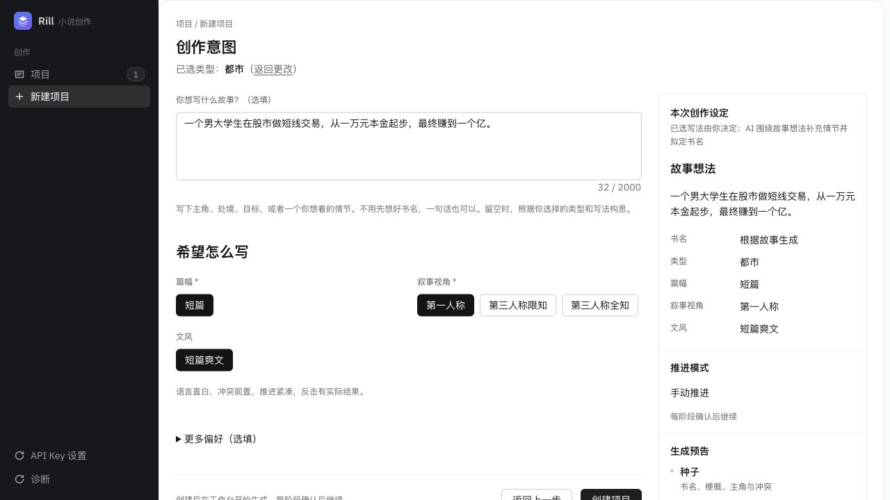

# 创作意图改版验收记录

日期：2026-10-25  
状态：实现与本地回归完成；真实模型样例待授权

## 已实现

- 故事想法独立多行输入、2000 字符计数与就地超长错误，填写内容进入 `answers.idea`。
- 移除阅读体验及主角职业，新建请求剔除旧客户端携带的对应字段；历史答案原样保留。
- 书名选填，和人物数量、类型偏好放入默认折叠的更多偏好。
- 摘要联动故事想法、书名与有效偏好；都市和言情不预告世界观。
- `titleSource` 区分作者、占位与系统拟名；正式生成及候选采用在同一事务内同步标题，预览不改标题。
- 窄屏表单与摘要改为单列，输入与摘要长文本可换行。

## 验证结果

| 检查 | 结果 |
| --- | --- |
| 后端全量单测 | 37 个套件，312 项通过；串行执行 |
| 后端全量 HTTP 测试 | 8 个套件，59 项通过；串行执行，模型使用模拟响应 |
| 前端回归 | 20 个套件覆盖 120 项；首轮 119 项通过，修正新摘要对应旧断言后，新建页面 9 项全部通过，其余 19 个套件已通过 |
| 前端全量限制 | 全量运行停滞于既有 `OutlineWorkbench.test.tsx`，已中止；回归显式排除该文件，不宣称全量通过 |
| 构建 | shared、backend、frontend 通过；保留现有前端包体体积告警 |
| lint | 前后端通过 |
| 数据库迁移 | 已备份后应用 `20261025090000_creation_intent_title_source` |
| 旧项目保护 | 迁移前后逐条对比 4 个旧项目，id、书名、问卷完全一致，标题来源均为 author |
| SQLite GC 检查 | 临时库 10000 次写入、50 次原生异步回调 GC、重新打开持久化校验通过 |
| 浏览器预览 | 都市示例的故事想法与第一人称选择同步到摘要，未显示阅读体验及主角职业 |

前端超长输入测试保留 2001 字符原文，显示就地错误并阻止请求。HTTP 覆盖无书名创建、旧字段剔除、正式生成标题同步、失败保留书名、作者标题保护及候选预览与采用边界。

## 真实模型验收待办

计划使用以下非敏感创意执行一次真实种子生成：

> 一个男大学生在股市做短线交易，从一万元本金起步，最终赚到一个亿。

检查主角身份、万元起点、亿元终点、开篇目标与最终目标区分，以及生成书名是否适合独立展示。此项需要将文本发送给 DeepSeek 并产生模型费用。

自动审批以缺少对该具体外部调用的明确授权为由拒绝执行，命令未运行，没有创建或删除真实验收项目。此项尚未通过，不能从提示词断言或模拟响应推断真实模型必然遵守故事设定。
