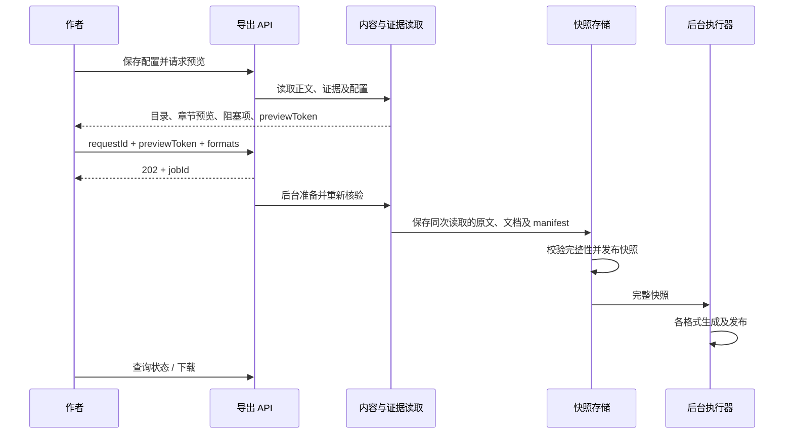

# Design

## Context

动机见 [proposal.md](./proposal.md)，行为以 [book-export 规格](./specs/book-export/spec.md) 和 [前端增量规格](./specs/novel-frontend/spec.md) 为准。

已核查的现状：

- `shared/src/index.ts` 的 `STAGES` 结束于 `prose`；`novel-pipeline` 要求最后一章有效接受后项目完成。导出无需修改该规则。
- `prose/prose-files.service.ts` 管理稳定输出目录、UTF-8、LF 规范化、SHA-256 与路径安全；数据库只存正文状态及证据，文件才是正文权威。
- `ProseService.detail()` 同时执行文件对账、候选稿读取及投影重建；不能直接把它当无副作用的导出输入，也不能仅信任它的 `completed`。
- `ProseService.dependencies()` 根据大纲、节拍及前文有效摘要生成依赖指纹，复制和导出必须复用同一语义，避免另建宽松门禁。
- `book.md` 是章节链接索引；正文首标题未强制统一。大纲提供章节标题，Project 与 Premise 均有标题，尚无作者及独立成书配置。
- PrismaService、正文及流水线 provider 当前集中在 `novel.module.ts`；工作台选择状态为 `Stage | null`，需区分创作阶段与导出视图。
- 现有项目永久删除流程有执行权与 `ProseDeletion` 清理记录，调用正文目录 purge；新导出目录放在其内部，必须先停止写入再删目录。
- 当前无下载接口、Markdown 转换或 EPUB 打包依赖；已有 Jest ESM、supertest、Vitest 设施可扩展。

## Goals / Non-Goals

**Goals:**

- 用一套内容准备逻辑连接正文、复制、预览与多格式输出，严格匹配接受证据。
- 将易变本地内容和长时间转换隔开；文件系统与 SQLite 非原子提交时仍可恢复并明确失败。
- 单机单后端实例即可运行，页面离开不影响任务；数据结构保留将来替换执行器的边界。

**Non-Goals:**

- 不把导出注册成 Stage，不接入 LangGraph、checkpoint 或模型用量。
- 不保证本地编辑器参与数据库事务，不承诺不同 EPUB 阅读器分页完全一致。
- 不引入通用分布式队列、跨实例调度或跨任务快照去重；首版每个任务独占快照，降低删除复杂度。
- 产品格式及内容范围沿用 proposal，不额外增加平台上传和排版配置。

## Decisions

### 1. 独立模块与共享正文读取边界

新增 `backend/src/novel/book-export/`：

| 组件 | 责任 |
| --- | --- |
| `BookExportController` | 配置、预览、复制、任务、下载及删除接口 |
| `BookExportService` | 用例编排与项目生命周期接入 |
| `BookContentService` | 解析、标题整理、预览及复制模式转换 |
| `BookSnapshotService` | 文件暂存、版本核验、manifest 发布 |
| `BookExportWorker` | 持久化任务领取、格式调度、恢复 |
| `BookExportFilesService` | 项目范围内临时文件、发布、下载与清理 |
| `renderers/` | TXT、Markdown、EPUB 转换器，只接受快照输入 |

抽出共享的 `ProseContentModule`，容纳已有 PrismaService、ProseFilesService 和接受证据读取/校验能力；`NovelModule` 与 `BookExportModule` 都导入该模块，避免重复注册 Prisma provider。`NovelModule` 导入 `BookExportModule`，流水线通过其导出的生命周期接口协调删除；导出模块不反向导入 NovelModule，也不注册 ArtifactRegistry 生成器。

现有依赖指纹算法抽成共享纯逻辑，正文与导出共用；上游数据读取保持既有阶段有效性语义。必要的外部修改对账与只读资格判断分离：发现变化不得直接继续交付，即便流水线运行中不允许写回对账结果，也应返回真实阻塞项。复制第 N 章需核验第 1 至 N 章及上游，后文未完成不阻塞它。导出运行快照形成后，不占用整个创作流水线执行权。

替代方案：直接调用 `detail()` 会额外读取候选稿和写投影，且运行中对账可能跳过；将 export 加入 Stage 会改变完成判定、确认及回退语义，均不采用。

### 2. 数据模型、配置和版本

新增模型，状态用 String、结构化字段用 JSON 字符串，所有读写均经过 shared zod schema：

| 模型 | 建议字段与约束 |
| --- | --- |
| `BookExportSettings` | `projectId` 唯一；`title/author/introduction`；`chapterTitles`；`revision`；时间戳 |
| `BookExportSnapshot` | `projectId`、内容指纹、证据版本标识、schema/转换版本、manifest 相对路径及哈希、ready 时刻 |
| `BookExportJob` | `projectId`、`requestId`、规范化请求哈希、可空 snapshotId、格式集合、状态、阶段、错误、attempt/fencing token、时间戳；`projectId + requestId` 唯一 |
| `BookExportFile` | `jobId + format` 唯一；状态、相对路径、MIME、大小、SHA-256、错误、尝试次数 |

快照与任务一对一，数据库记录允许在 preparing 时尚无快照；就绪后快照只读。设置保存使用 expectedRevision；不存在配置时返回种子预填及 revision=0，首次保存才持久化，不在 GET 时写配置。种子尚不存在则书名留空，作者填写后再保存；章节复制可使用默认章名，不要求先保存成书配置。配置保存采用内容比较，原样保存不增加实质内容版本。

展示标题覆盖以章号及所属大纲版本关联，避免大纲重排后静默套用旧标题；大纲版本变化后标为待核对，保留旧值，由作者重新保存确认覆盖或恢复默认，再允许整书导出。覆盖的修改不撤销正文接受。

区分两类标识：

- `contentFingerprint`：对稳定序列化的书籍信息、顺序、展示标题、LF 正文哈希及转换规则版本计算哈希，决定文件是否与当前交付内容一致；不包含时间戳、设置 revision 和随机 ID。
- `previewToken`：绑定上述内容及当前大纲、节拍、接受、报告、摘要和依赖证据版本。即便文字相同，接受证据改变也必须重新核验；不能用内容相同绕过接受门禁。

配置和正文重新变回完全相同的交付内容时可显示内容一致，但当前有效性须单独通过校验；无法读取当前内容时显示 `unverifiable`。历史记录不存一个永远有效的 isLatest 布尔值。

### 3. 内容解析、标题与复制

采用 Markdown AST 解析，统一生成中间章节文档，保留原文、位置范围和有效节点。首版白名单为段落、标题、普通文本、强调、分隔线；常规链接可保留文字与安全链接，但不请求资源。图片、表格、代码块、列表等未支持节点及原始 HTML 产生带章号和位置的阻塞诊断，禁止静默裁掉。

标题规则：只考察第一个非空顶层标题节点；它与大纲原章名、展示章名、纯章号，或约定的“第 N 章 + 章名”精确规范化匹配时，视为同章标题。规范化只处理空白及明确章号前缀，不做模糊语义猜测。匹配后去掉该节点，输出统一“第 N 章 展示标题”；没有首标题则直接添加，疑似标题但不匹配则阻塞并提示本地修改或核对展示标题。后续小标题保留。

复制模式为 `plain-with-title`、`plain-body`、`markdown-source`。前两者经 AST 生成并保留段落；后者返回 LF 规范化后的完整原文，保留源标题，与标题整理后的整书 Markdown 区分。原文复制仍受接受有效性门禁约束，但不因无需转换的 AST 不支持节点而失败；前端以纯文本呈现。复制响应包含本次 sourceHash 与核验时间，含义为操作读取时的有效版本，不承诺剪贴板写入后文件不会再变化。

替代方案：正则全局删 Markdown 容易误伤正文，三个转换器自行解释正文容易不一致；统一 AST 及位置诊断更便于验证。

### 4. 从预览到不可变快照



创建任务先做参数及轻量版本校验，后台完整校验仍以 previewToken 为条件，晚到的冲突作为 preparing 失败记录展示，不生成文件。请求标识在数据库唯一约束下绑定规范化参数；重传返回原任务，不同参数返回 409。前端提交中禁用按钮，网络超时重传复用原 requestId；作者显式新导出使用新标识。

准备算法：

1. 读取当前配置、大纲、节拍、阶段有效状态及接受证据，在项目安全路径中逐章读取源文件，保存实际 LF 内容及哈希。
2. 验证本章审核通过或有效覆盖授权、接受摘要、ProseAcceptance、源哈希与前文依赖指纹；逐章重算依赖，不能只比较 observedHash 和 confirmedHash。
3. AST 校验并生成预览同规则的文档，计算内容指纹；将完整原文和转换输入写入 `.preparing-{attempt}` 目录。
4. 在短数据库事务内重新读取并比较配置与全部版本证据，确认项目未删除、任务仍持有执行权、previewToken 一致。事务中不做模型调用或长文件读写。
5. 写完 manifest、核对各文件哈希并发布 ready 目录，再在最终事务中复验第 4 步的全部版本证据、项目存活与执行权，以条件更新将 snapshot ready 与任务 generating 关联；不匹配则失败并清理未关联目录。事务与文件发布间的间隙由恢复协议处理。

快照内内容匹配同组有效接受证据即可成立；不宣称外部文件有全书原子时点。本地编辑器在读取后保存新内容，若数据库尚未记录变化，快照仍代表之前已接受版本；生成器继续使用该版本，状态刷新时重新读取当前正文并显示历史或无法验证。已进入数据库的失效、回退、接受版本变化必须被第 4 步捕获。

替代方案：仅应用锁挡不住本地编辑器；转换时逐章再读源文件会混版；数据库事务内完成文件转换会长时间占锁，均不采用。

### 5. 三种格式与文件发布

输出结构固定：标题和可选作者 → 可选简介 → 目录 → 章节正文。TXT 为 UTF-8 文本；Markdown 使用显式稳定章节锚点，避免重复章名破坏目录。EPUB 使用可重排章节 XHTML、导航目录、元数据及 spine 顺序；作者为空不伪造 creator。ZIP 中 `mimetype` 首项且不压缩，包含 container、包清单和内部样式，所有 XML 转义及 ID 唯一，资源全部在包内，不引用远程图片或字体。分页是章节起始语义，不承诺阅读器物理页码。

Markdown AST 与 ZIP 库按 Node 24、ESM、许可和流式/内存行为选择；本提案不虚构已安装依赖或锁定未经验证的版本。EPUB 包结构测试加实际阅读器抽查，不能只检查文件扩展名。

目录示例：

```text
output/{projectId}/exports/{jobId}/
  snapshot/
    manifest.json
    chapters/001.md
    documents/001.json
  files/
    book.txt
    book.md
    book.epub
```

复用 `PROSE_OUTPUT_DIR`，绝不使用书名构造内部路径。文件先写带 attempt 标识的临时文件，完成校验后 rename 发布，再将大小与哈希写入数据库。下载名称由快照书名清理控制字符后生成，内部路径仍为固定名称。现有根 `book.md` 投影继续保留，不改变含义。

### 6. 任务状态、恢复和资源控制

任务状态建议为 `preparing/generating/succeeded/partial_failed/failed/paused/deleting/delete_failed`；格式状态为 `pending/generating/succeeded/failed`，暂停原因单独记录。聚合状态根据所选格式计算，错误为结构化 code/message/chapter/position，可保留原始 cause 于内部诊断，但不输出密钥或完整正文到日志。

单进程队列默认一次处理一个格式，逐章读取快照，避免同时构建多个整书副本阻塞事件循环；无百分比依据时只报告当前步骤及已完成格式数。数据库条件更新领取任务，attempt/fencing token 防止超时、删除或恢复后的旧运行提交。暂停或删除需在创建临时文件、发布文件及提交状态前检查执行权。

重启恢复：

- preparing 未提交 ready：标记失败并清理临时目录，即使有未关联 ready 目录也不得猜测为已接受快照；保留诊断，重新发起。
- 已关联完整快照：验证 manifest 与章节文件哈希，恢复未完成格式；缺损快照明确失败，不读取最新正文替换。
- 正式文件已发布但状态未提交：只有能核对本次 attempt 发布证据、格式、快照指纹及校验和才补记成功，否则清理并重新转换该格式。
- 仅有临时文件：丢弃该 attempt 临时产物，基于原快照重新执行；成功格式不重跑。
- 旧转换规则不受当前执行器支持：已有成功文件仍可下载，恢复失败格式明确报版本不兼容，不用新规则冒充原快照输出。

成功文件后来丢失或损坏时标记不可用，该格式可基于完整原快照重建，任务状态重新聚合；重试不改变其他成功格式。

替代方案：请求内同步生成无法跨页面及进程恢复；Redis 队列超出首版运维需求。持久状态与执行器分离，未来可替换调度层。

### 7. API 契约与错误

统一前缀 `/api/novel/projects/:id/book-export`，契约先定义于 shared：

| 方法与路径 | 输入 / 输出 |
| --- | --- |
| `GET /settings` | 当前配置、revision、默认章名及待核对标题 |
| `PATCH /settings` | expectedRevision + 配置；返回新配置 |
| `POST /preview` | 可选选中章节；返回书籍信息、完整目录、选中章预览、资格诊断、previewToken |
| `POST /chapters/:number/copy` | mode；返回即时核验的 text、sourceHash |
| `POST /jobs` | requestId、previewToken、formats；202 返回持久化任务 |
| `GET /jobs` | 分页历史及内容版本状态 |
| `GET /jobs/:jobId` | 任务、各格式状态、错误与下载能力 |
| `POST /jobs/:jobId/retry` | 失败或不可用格式的子集；返回当前任务 |
| `GET /jobs/:jobId/files/:format` | 校验成功文件后流式返回 |
| `DELETE /jobs/:jobId` | 标记清理并停止执行；202 返回删除进度，完整清理后查询为 404 |

预览避免一次向前端发送全书正文：返回完整目录及一章内容，切章仍使用同一 token 校验；token 变化提示重新预览。未完整生成时可查看已存在正文预览，但没有可提交整书任务的 token；仅有效接受章节可复制。

下载设置正确 MIME、UTF-8 Content-Disposition 与大小；预先打开并核验文件，错误仍返回 JSON，不以 200 交付错误文本。所有 task/file 查询均约束 projectId；禁止客户端提供路径。400 用于格式、章号及字段非法，404 用于项目/任务不可达或文件缺失，409 用于配置/预览/执行冲突，422 用于有效性或转换范围阻塞，存储故障返回明确服务错误。异步失败保存在任务，不依靠已结束 HTTP 响应传递。

历史版本状态依据当前安全读取计算，可按相同内容读取复用结果但不得用未核验旧缓存断言 latest。下载旧文件不要求最新正文仍有效。

### 8. 前端状态与流程

保持 React + Ant Design 桌面工作台风格。将前端查看目标扩展为判别联合：`{ kind: 'stage', stage: Stage } | { kind: 'book-export' } | null`，修改 `useWorkspaceProject.ts`、`App.tsx` 侧栏与 `ProjectWorkspacePage.tsx` 的分流，不把字符串 export 强转 Stage。导出页不呈现“确认并推进”按钮。

导出页顺序：书籍信息表单 → 章节列表/预览 → 格式选择与导出 → 历史。正文页在 `ProseChapterActions.tsx` 接入同一个复制组件；偏好存浏览器 localStorage，禁止存正文。书籍编辑 dirty 时阻止预览和新导出，旧配置保存冲突保留编辑。预览显示标题整理结果及诊断；格式可多选，未选格式不可提交。

运行任务独立轮询，在终态停止，页面重进重新获取；不会因 Project.status=done 提前停止导出轮询。下载用 Blob/流并验证状态和 MIME，释放 object URL。复制必须由用户操作触发，权限失败显示本次服务端核验的只读文本供手动复制；不能虚报成功或回退复制旧缓存。

### 9. 删除、软删除与备份

导出任务删除先设置 deleting 并撤销执行 token，协调 worker 结束/中止活动写入，再删除任务私有目录，最后事务删除文件、快照及任务记录。任一步清理失败保留 delete_failed 及路径、错误，允许同一 DELETE 重试；重启扫描删除中的记录继续清理。新下载在 deleting 后拒绝，已打开的下载按操作系统语义完成或终止，不删除后另建同路径产物。

项目软删除与导出任务领取/发布使用同一项目生命周期门禁：先阻止新导出操作并暂停任务，协调写入，保留文件。已经准备中的任务暂停后恢复时按 preparing 中断规则失败；完整快照上的转换可恢复。新操作、轮询、复制及下载均查询 deletedAt，残留 worker 在每次发布和提交前核验。恢复项目后启动导出恢复扫描，先确认不存在永久清理记录。

`PipelineService.purgeProject()` 清理目录前调用导出暂停/撤销写入接口；已有整个项目目录 purge 同时覆盖 exports，数据库关联按项目级联。清理失败继续利用现有项目删除记录，不提前删掉重试所需元数据。单任务删除不影响正文与其他任务。备份仍为 SQLite、checkpoint 及完整 output 三部分，导出文件与快照包含在 output 中。

## Risks / Trade-offs

- [外部文件变化不能与数据库原子锁定] → 交付绑定实际读取内容和有效证据；后续修改视作新版本，绝不宣称锁住编辑器。
- [接受判定抽取可能影响现有正文] → 保留既有接受/复核回归，加入前文变化、人工覆盖、摘要缺失及运行中读取场景。
- [每次保存完整快照占磁盘] → 首版不自动清理，显示文件大小及删除入口；磁盘满明确失败，不覆盖正文。跨任务去重延后。
- [文件系统与 SQLite 双写存在间隙] → manifest、临时路径、attempt 发布证据和恢复扫描；不能证明完整时失败，不猜测成功。
- [EPUB 阅读器差异及解析范围偏窄] → 包结构校验、中文标题/特殊字符样本和实际阅读器抽查；不支持节点定位后由作者处理。
- [进程内转换占用资源] → 低并发、逐章处理和流式输出，避免整书多份驻留；首版明确单实例运行边界。
- [配置、大纲标题覆盖与本地文件同时变化] → 配置 CAS、覆盖关联大纲版本、预览 token 与提交复验，保存冲突保留编辑。

## Migration Plan

1. 先新增 shared 契约、迁移及默认空状态；不回填作者、不改现有项目标题、正文、STAGES 或完成状态。
2. 迁移新表、生成 Prisma client，再接入共享读取边界、后端任务与接口；确保旧项目未保存导出配置也能正常续写。
3. 接入导出页面、复制及下载；更新 README 的导出、支持结构、单实例恢复和备份说明，修正过时阶段描述仅在相关段落内进行。
4. 在临时数据库和临时输出目录跑契约/单测/e2e、前端测试，执行全量 test、lint、build 与格式检查；本地生成 EPUB 后验证包与阅读器。
5. 发布前备份数据库和完整 output。若回滚应用，先停止 worker，不删除新表及 output/exports；旧版本继续使用原正文表和文件。只有明确放弃历史导出时才另行执行破坏性清理，不能自动逆向迁移丢失文件。
